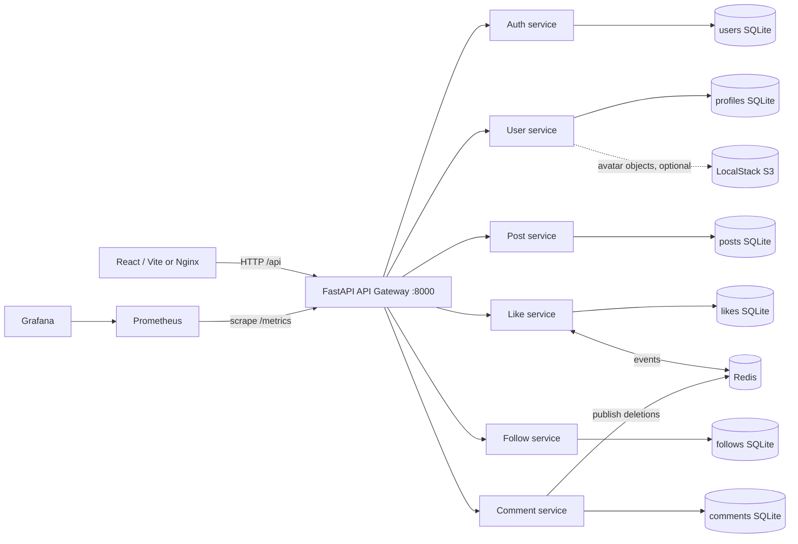
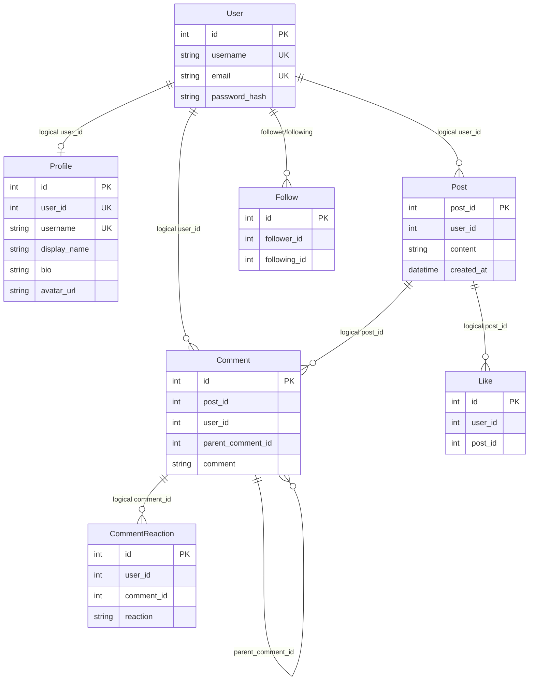

# Cloud Social Platform

A development-stage social network built as six Python/FastAPI services behind an API gateway, with a React + TypeScript frontend. Users can register, sign in, manage profiles, publish/edit/delete posts, follow other users, and comment/react to content. The gateway handles JWT checks, routing, rate limits, request limits, circuit breakers, basic enrichment, observability, and best-effort cross-service deletion cleanup.

**Status:** Source-level repairs and checks are included in this repository. The full Docker stack has **not** been verified in this audit environment; see [Testing](#14-testing-and-quality-assurance) and [Known issues](#18-known-issues-and-limitations). This is a learning/development system, **not a production-ready social network**.

## 1. Overview and features

| Feature | Implementation | Primary owner |
|---|---|---|
| Registration, password login, 30-minute JWT, current account | Implemented | `auth-service` |
| Own and public user profiles, profile search, display name and bio | Implemented | `user-service` |
| Avatar upload and display | Implemented, **requires working S3-compatible storage** | `user-service` |
| Feed, own/other posts, creating/editing/deleting posts | Implemented | `post-service` + gateway |
| Post likes and comment like/dislike | Implemented | `like-service` |
| Follow/unfollow, follower lists/counts | Implemented | `follow-service` |
| Comments, nested replies, editing and deleting comment branches | Implemented | `comment-service` |
| Cascade deletion of related comments/likes | Best-effort, partial failure possible | gateway, comments, likes, Redis |
| Monitoring (Prometheus/Grafana) | Configured, not independently deployment-tested in this audit | gateway + monitoring containers |
| Refresh tokens, notifications, chat, granular roles, moderation | Not implemented | — |

## 2. Architecture



Every service owns a separate SQLite database and **does not query another service's database**. References such as `posts.user_id` and `comments.post_id` are logical cross-service IDs, not database foreign keys. Public, protected, and internal-only routes are distinguished at the gateway or inside service handlers. Internal cascade endpoints require the shared `INTERNAL_SERVICE_SECRET`. The gateway enriches post/comment lists with profile information via HTTP. JWT `sub` contains the user ID, and services validate the signature using the same `SECRET_KEY`.

**Important:** Separate databases establish ownership but do not automatically guarantee distributed consistency. Delete workflows use background HTTP calls and Redis pub/sub instead of a durable transaction/outbox.

## 3. Stack and project layout

- Python **3.13** Docker images; FastAPI, Uvicorn, SQLAlchemy and SQLite, `python-jose`, Passlib/bcrypt, Pydantic; `httpx` in the gateway, `redis` in gateway/likes/comments, `boto3` in the user service.
- React **18**, TypeScript, Vite **5**, React Router **6**, Axios; production frontend served by Nginx.
- Docker Compose, Redis **7**; Prometheus (image currently `latest`), Grafana **12.0.2**; optional LocalStack (currently `latest`). The unpinned backend packages will resolve to versions available at image-build time; refer to individual `requirements.txt` files and the frontend lockfile for details.

```text
cloud-social-platform/
├── docker-compose.yml             # service orchestration and persistent volumes
├── .env.example                   # root configuration template (never commit .env)
├── README.md, AUDIT_REPORT.md
├── gateway/                       # routing, auth, limits, metrics, resilience
│   ├── main.py
│   ├── requirements.txt
│   └── Dockerfile
├── services/
│   ├── auth-service/              # users.db
│   ├── user-service/              # profiles.db, S3 avatars
│   ├── post-service/              # posts.db
│   ├── like-service/              # likes.db and Redis listener
│   ├── follow-service/            # follows.db
│   └── comment-service/           # comments.db and Redis publisher
│       (each service contains main.py, requirements.txt, Dockerfile)
├── frontend/
│   ├── src/api/                   # Axios contracts
│   ├── src/auth/                  # token storage, protected routes
│   ├── src/components/            # posts, comments, profile, layout, UI
│   ├── src/pages/                 # feed, discover, profiles, login, register
│   ├── src/routes/AppRoutes.tsx   # route table
│   ├── nginx.conf, Dockerfile, vite.config.ts
│   └── package.json, package-lock.json
├── observability/
│   ├── prometheus/prometheus.yml
│   └── grafana/                   # provisioning and dashboards
├── scripts/localstack/init-s3.sh  # development S3 bucket init
├── tests/                         # independent source tests and API regression tests
├── test_*.sh                      # Docker-backed functional/operational checks
├── diagnose.sh
└── run-local.sh                   # optional non-Docker backend development
```

## 4. Prerequisites

- Docker Engine/Desktop with Compose v2, accessible on your computer. The Compose examples assume ports 3000, 8080, 3001 and 9090 are unused; port 4566 is additionally needed when using LocalStack.
- For standalone development: **Python 3.13**, **Node.js 22**, npm, and optionally a running Redis server. For avatar uploads, you must also start/configure an S3-compatible service.
- Disk space for container images and six SQLite named volumes. Size will grow with users/content.

## 5. First-time Docker setup

Run from the **repository root**:

```bash
cp .env.example .env
```

Edit `.env` and replace `SECRET_KEY`, `INTERNAL_SERVICE_SECRET` and `GRAFANA_ADMIN_PASSWORD` with **different, cryptographically random strings**. For example, generate each secret separately with `python -c "import secrets; print(secrets.token_urlsafe(48))"`. Do not expose or commit `.env`. The two service secrets must be the same *across containers* through the common root `.env` file, but **different from each other**.

```bash
docker compose config         # check interpolation and syntax
docker compose up -d --build  # build and start default stack
docker compose ps             # inspect state / health
curl http://localhost:8080/health
```

Open **http://localhost:3000** (frontend). Default containers include the gateway and six APIs, Redis, Prometheus and Grafana. **Avatar uploads will not function until S3/LocalStack is started.** To opt into development S3, configure a working `LOCALSTACK_AUTH_TOKEN` if your chosen image/version requires one, then run:

```bash
docker compose --profile localstack up -d --build
```

The LocalStack ready script initializes the bucket and grants **development-only** read access to `avatars/*`. Do not carry that public-read bucket policy into production. LocalStack may require an account/token depending on its release; the `latest` image is not reproducible across time.

### Ports and URLs

| External URL | Purpose |
|---|---|
| `http://localhost:3000` | Nginx-served React app |
| `http://localhost:8080` | Public gateway; all client calls use `/api/...` |
| `http://localhost:8080/health` | Gateway/dependency health summary |
| `http://localhost:8080/metrics` | Prometheus format metrics |
| `http://localhost:8080/metrics/json` | JSON metrics |
| `http://localhost:9090` | Prometheus |
| `http://localhost:3001` | Grafana |
| `http://localhost:4566` | LocalStack, **only with profile** |

Individual Python APIs listen on port `8000` **inside the Compose network**; they are not published on the host. Redis `6379` is also internal-only in Compose.

## 6. Commands for running and maintenance

```bash
docker compose logs -f gateway
# replace gateway with a service name to inspect that container
docker compose ps
docker compose down                # stops containers, KEEPS database volumes
docker compose up -d --build      # recreate containers with the same data volumes
```

**Data safety:** `docker compose down -v` **removes the database volumes** and can permanently delete user data. Do not run it for routine troubleshooting. Take volume/database backups first. For consistent SQLite backups use SQLite's backup API or `sqlite3 .backup` while writes are quiesced; do not simply overwrite a live database file. Schema setup uses SQLAlchemy `metadata.create_all()`, with a small legacy `avatar_url` ALTER TABLE in the profile service. **No general migration framework is implemented.**

### Standalone backend and Vite development

Install requirements (inside a Python virtual environment), then use the local runner, which assigns service ports `8001`–`8006` and gateway `8000`:

```bash
python -m venv .venv
source .venv/bin/activate
./run-local.sh --install
```

On first run, `run-local.sh` can create `.env` from `.env.example` with new random signing/internal secrets. For the frontend in another terminal:

```bash
cd frontend
npm ci
cp .env.example .env
npm run dev
```

The default frontend dev API base is `/api`; `vite.config.ts` proxies it to **http://localhost:8080** (Docker gateway). If you are using **only** the standalone backend instead, set `VITE_API_BASE_URL=http://127.0.0.1:8000` in `frontend/.env` or change the Vite proxy target. Vite reloads environment values on restart. Be aware that `run-local.sh` does not start Redis/S3; configure them separately for rate limits/events/avatar uploads.

## 7. Configuration reference

Variables in `.env` are made available to Python services and the gateway via `env_file`. The per-service SQLite URLs and the gateway's Compose networking values are provided by `docker-compose.yml` as explicit overrides. An unset optional variable uses the **source-code default** shown below; an empty string is not necessarily equivalent to unset.

| Variable(s) | Consumers | Purpose / default / requirement |
|---|---|---|
| `SECRET_KEY` | all Python services and gateway | **Required** shared JWT HMAC signing key, no code default |
| `INTERNAL_SERVICE_SECRET` | gateway, likes, comments | **Required** internal cleanup authorization, no code default |
| `AUTH_DATABASE_URL` | auth | Optional for local execution (`sqlite:///users.db`); Docker overrides `sqlite:////app/data/users.db` |
| `USER_DATABASE_URL` | user | `sqlite:///profiles.db` locally, Docker `/app/data/profiles.db` |
| `POST_DATABASE_URL` | post | `sqlite:///posts.db` locally, Docker `/app/data/posts.db` |
| `LIKE_DATABASE_URL` | like | `sqlite:///likes.db` locally, Docker `/app/data/likes.db` |
| `FOLLOW_DATABASE_URL` | follow | `sqlite:///follows.db` locally, Docker `/app/data/follows.db` |
| `COMMENT_DATABASE_URL` | comment | `sqlite:///comments.db` locally, Docker `/app/data/comments.db` |
| `AUTH_SERVICE_URL`, `USER_SERVICE_URL` | gateway | Upstream base URLs; Docker `http://auth-service:8000`, `http://user-service:8000` |
| `POST_SERVICE_URL`, `LIKE_SERVICE_URL` | gateway | Docker `http://post-service:8000`, `http://like-service:8000` |
| `FOLLOW_SERVICE_URL`, `COMMENT_SERVICE_URL` | gateway | Docker `http://follow-service:8000`, `http://comment-service:8000` |
| `REDIS_URL` | gateway | Default `redis://redis:6379/0`; Docker uses Redis backend |
| `REDIS_HOST` | likes, comments | Default `redis` |
| `RATE_LIMIT_BACKEND` | gateway | Default `memory`; Compose overrides to `redis` |
| `RATE_LIMIT_KEY_PREFIX` | gateway | Default `gateway:rate_limit` |
| `GATEWAY_RETRY_ATTEMPTS` | gateway | Default `2`, applies to safe methods |
| `GATEWAY_RETRY_BACKOFF_SECONDS` | gateway | Default `0.15` |
| `CIRCUIT_FAILURE_THRESHOLD` | gateway | Default `3` |
| `CIRCUIT_COOLDOWN_SECONDS` | gateway | Default `10` |
| `MAX_REQUEST_BODY_SIZE_BYTES` | gateway | Code default 1 MiB; `.env.example` sets **3 MiB** to allow 2 MiB avatars with multipart overhead |
| `LOG_LEVEL` | gateway | Default `INFO` |
| `CORS_ORIGINS` | gateway | Optional comma-separated list; code has localhost development origins |
| `AWS_ENDPOINT_URL`, `AWS_REGION` | user | Defaults `http://localstack:4566`, `us-east-1` |
| `AWS_ACCESS_KEY_ID`, `AWS_SECRET_ACCESS_KEY` | user | Defaults `test` for local development, **not production credentials** |
| `S3_BUCKET_NAME` | user, LocalStack init | Default `cloud-social-platform-media` |
| `PUBLIC_S3_BASE_URL` | user | Browser-reachable object URL prefix; development default `http://localhost:4566/<bucket>` |
| `LOCALSTACK_AUTH_TOKEN` | optional LocalStack | No usable default; may be required by image vendor/version |
| `GRAFANA_ADMIN_USER`, `GRAFANA_ADMIN_PASSWORD` | Grafana Compose | Set in `.env`; sample user `admin`, password **must be changed** |
| `VITE_API_BASE_URL` | frontend build/dev | `/api` for Vite dev proxy or absolute gateway host; Docker build arg uses `/api` for the Nginx same-origin proxy |

`GATEWAY_RETRY_*`, circuit-breaker values, backend URLs, and Redis settings must agree with the deployment network. Do not put any authentication secrets in Vite `VITE_*` variables: those values are bundled into public browser JavaScript.

## 8. Service responsibilities

| Service | Main module | Persistence / other dependencies | Internal port | Health |
|---|---|---|---|---|
| auth-service | `services/auth-service/main.py` | `users.db`, bcrypt/JWT | 8000 | `/health` |
| user-service | `services/user-service/main.py` | `profiles.db`; optional S3 | 8000 | `/health` |
| post-service | `services/post-service/main.py` | `posts.db` | 8000 | `/health` |
| like-service | `services/like-service/main.py` | `likes.db`, Redis events listener | 8000 | `/health` |
| follow-service | `services/follow-service/main.py` | `follows.db` | 8000 | `/health` |
| comment-service | `services/comment-service/main.py` | `comments.db`, Redis publisher | 8000 | `/health` |
| gateway | `gateway/main.py` | HTTPX upstream clients, Redis optional | 8000 (host 8080) | `/health` |

Every FastAPI service normally has Swagger at `http://<container-name>:8000/docs` **from within the Docker network**, or via its standalone local port (`8001`–`8006`). The gateway's autogenerated `/docs` only describes its explicit routing and generic catch-all; it is **not** a substitute for the service APIs described next.

## 9. API inventory and contracts

**Client URL:** prepend `http://localhost:8080/api` to the API paths below. Gateway `auth` routes translate `/api/auth/*` to auth service `/*`. `/api/users/*` and `/api/profiles/*` are aliases for the profile service. `POST /api/posts` is translated to `POST /posts/me`; `POST /api/posts/me` also works. All routes marked **JWT** require `Authorization: Bearer <access_token>`. `Internal` endpoints cannot be called via the public gateway route allowlist and require `X-Internal-Service-Secret` for direct, trusted service calls.

### Auth and profiles

| Method and gateway path | Access | Body / purpose / response |
|---|---|---|
| `POST /auth/register` | Public | `{username: str (3–30), email: valid email, password: str (8–72)}` → registration confirmation; duplicate username/email **409** |
| `POST /auth/login` | Public | `{identifier: username_or_email, password}` → `{access_token, token_type}`; invalid credentials **401** |
| `GET /auth/me` | JWT | `{id, username, email}`; expired/invalid token **401** |
| `POST /profiles/me` | JWT | `{display_name: str (3–50), bio?: str (max 200)}` → created profile; duplicate **400** |
| `GET /profiles/me` | JWT | Current profile; creates a default profile if missing |
| `PUT /profiles/me` | JWT | `{display_name?, bio?}` → updated profile; missing profile **404** |
| `DELETE /profiles/me` | JWT | Removes profile row only; **does not delete auth user or their posts** |
| `POST /profiles/me/avatar` | JWT | multipart `avatar` PNG/JPEG/WebP/GIF ≤2 MiB → profile including `avatar_url`; S3 must be reachable; **400/413/503** possible |
| `GET /profiles/search?q=...` | Public | Up to 20 profiles matching **username or display name** (literal case-insensitive substring) |
| `GET /profiles/{username}` | Public | Public profile; username matched case-insensitively; **404** missing |
| `GET /profiles/user/{user_id}` | Public | Profile by integer user ID; **404** missing |

Typical profile response contains `{id, user_id, username, display_name, bio, avatar_url}`.

### Posts

| Method and gateway path | Access | Purpose / response |
|---|---|---|
| `GET /posts` | Public | Array of posts newest first; gateway enriches with profile fields if found |
| `POST /posts` or `/posts/me` | JWT | `{content: str (1–500)}` → created post object `{post_id,user_id,content,created_at}` |
| `GET /posts/me` | JWT | Array of current user's posts |
| `GET /posts/user/{user_id}` | Public | Array of that user's posts |
| `PUT /posts/{post_id}` | JWT/owner | `{content: str (1–500)}` → updated post; **403** non-owner / **404** missing |
| `DELETE /posts/{post_id}` | JWT/owner | Deletes post; gateway requests asynchronous comment/like cleanup |

### Follows

| Method and gateway path | Access | Purpose / response |
|---|---|---|
| `POST /follows` | JWT | `{target_user_id: positive int}` → `{following:true}`; following yourself **400** |
| `DELETE /follows/{target_user_id}` | JWT | Unfollow → `{following:false}` |
| `GET /follows/me` | JWT | `{following:[{following_id}]}` |
| `GET /follows/me/followers` | JWT | `{followers:[{follower_id}]}` |
| `GET /follows/status/{target_user_id}` | JWT | `{is_following:boolean}` |
| `GET /follows/users/{user_id}/followers` | Public | `{followers:[{follower_id}]}` |
| `GET /follows/users/{user_id}/following` | Public | `{following:[{following_id}]}` |
| `GET /follows/users/{user_id}/stats` | Public | `{followers_count, following_count}` |

### Likes and comment reactions

| Method and gateway path | Access | Purpose / response |
|---|---|---|
| `GET /likes/me` | JWT | `{likes:[{post_id}]}` |
| `POST /likes/posts/{post_id}` | JWT | Like post (idempotent for same user) |
| `DELETE /likes/posts/{post_id}` | JWT | Unlike post |
| `GET /likes/posts/{post_id}/count` | Public | `{post_id, like_count}` |
| `GET /likes/comments/me` | JWT | Comment IDs the caller liked |
| `POST /likes/comments/batch-reactions` | JWT | JSON integer array of IDs → `{reactions:{id:"like" or "dislike"}}` |
| `POST /likes/comments/{comment_id}` | JWT | Like comment |
| `POST /likes/comments/{comment_id}/dislike` | JWT | Dislike comment |
| `DELETE /likes/comments/{comment_id}` | JWT | Remove current user's reaction |
| `GET /likes/comments/{comment_id}/reaction` | JWT | Current user's reaction (or `null`) |
| `GET /likes/comments/{comment_id}/count` | Public | Comment reaction counts |
| `DELETE /likes/posts/{post_id}/all` | Internal | Delete all post likes; header `X-Internal-Service-Secret` |
| `DELETE /likes/comments` | Internal | JSON integer array of comment IDs; delete all their reactions |

### Comments

| Method and gateway path | Access | Purpose / response |
|---|---|---|
| `POST /comments` | JWT | `{post_id:int, comment:str (1–300), parent_comment_id?:int|null}` → comment object; parent must exist in same post |
| `GET /comments/post/{post_id}` | Public | `{comments:[{id,user_id,post_id,parent_comment_id,comment}]}`; gateway enriches list |
| `GET /comments/user/me` | JWT | Current user's comments and replies |
| `PUT /comments/{comment_id}` | JWT/owner | `{comment:str (1–300)}` → edited comment; **403** non-owner |
| `DELETE /comments/{comment_id}` | JWT/owner | Deletes comment and descendant replies, returns `deleted_ids`; gateway queues like cleanup |
| `DELETE /comments/post/{post_id}` | Internal | Deletes all comments of a deleted post, returns IDs and publishes a Redis event |

Other service-level routes: `GET /health` is implemented on every service. Gateway endpoints `GET /health`, `GET /metrics`, and `GET /metrics/json` are public. Unsupported method/path pairs are rejected by the gateway allowlist with a **404**. Pydantic payload validation commonly returns **422**; auth failures **401**; network/circuit failures can produce **503/504**, and request-size enforcement **413**.

### Request examples (illustrative, not runtime-verified here)

```bash
curl -X POST http://localhost:8080/api/auth/register \
  -H 'Content-Type: application/json' \
  -d '{"username":"alex","email":"alex@example.com","password":"example-pass-123"}'

curl -X POST http://localhost:8080/api/auth/login \
  -H 'Content-Type: application/json' \
  -d '{"identifier":"alex","password":"example-pass-123"}'
# Copy access_token from the response into TOKEN for subsequent commands.
curl http://localhost:8080/api/auth/me -H "Authorization: Bearer $TOKEN"
curl -X POST http://localhost:8080/api/posts/me \
  -H "Authorization: Bearer $TOKEN" -H 'Content-Type: application/json' \
  -d '{"content":"Hello from the cloud!"}'
```

## 10. Database models and relationships

Each box below is stored in a **different SQLite database** except `Like` and `CommentReaction`, which share `likes.db`:



Uniqueness constraints include auth username/email, profile user ID/username, a follower-following pair, a user-post like pair, and a user-comment reaction pair. SQLite autoincrement is explicitly used for posts/comments/likes to reduce dangerous ID reuse. No automated service-to-service referential integrity is implemented. The gateway and services use the configured SQLite files and call `create_all()` on startup; running new schema changes requires a **planned migration**, not automatically deleting the database.

## 11. Authentication and security

- Passwords are hashed by Passlib using bcrypt; no plaintext passwords should be stored. Auth-service emits an HS256 JWT with `sub`, `email`, `username`, and `exp` (currently 30 minutes).
- The gateway checks JWTs before forwarding protected routes, while the service checks again for ownership or user-scoped actions. There is **no refresh-token mechanism** or OAuth/social login.
- JWT key and internal-service key are distinct root `.env` values. **Never reuse the example secret strings in public deployments.** Internal cleanup routes require a separate header secret, but do not replace network isolation or TLS.
- The gateway enforces a route allowlist, timeouts, retry rules for safe methods, per-route rate limits, circuit breakers and request body limits; these are not a substitute for a comprehensive abuse-prevention program.
- Uploaded avatars are checked for allowed content type, format magic bytes and max size. Blocking S3 I/O is moved to a thread. The app returns a generic 503 when storage is unavailable rather than leaking exception details.
- Docker containers run as non-root app users. Redis is not published to the host. LocalStack's development-only public object policy must be replaced with private objects/signed URLs and proper access control for production.
- CORS is limited to configured frontend origins, but defaults include localhost development origins; set `CORS_ORIGINS` explicitly outside local development.

## 12. Frontend

`frontend/src/routes/AppRoutes.tsx` declares the home redirect, `/login`, `/register`, `/feed`, `/profiles`, `/my-posts`, `/profile/me`, `/profile/:username`, and 404. Protected routes check local JWT presence; actual API requests still require backend token verification. `frontend/src/api/` is the Axios contract layer; the bearer token is attached by `client.ts`. The token is saved in browser localStorage (client-side exposure risk from XSS). `useCurrentUser` fetches current account metadata, and `PostCard` handles editing/deleting, reactions, and nested comments.

To build: `cd frontend && npm ci && npm run build`; build artifacts go to `frontend/dist/`. Nginx serves the SPA and includes an `/api/` reverse proxy to the gateway. The Docker build sets the API base to **`/api`**, so the Nginx same-origin reverse proxy reaches the Compose gateway without hardcoding visitors' `localhost`. `UserProfilePage.tsx` is retained and repaired but the main router currently uses `ProfilePage.tsx` for public profile URLs. Search supports case-insensitive username and display-name matches.

## 13. Gateway operations / error handling

`gateway/main.py` contains middleware for request IDs, structured JSON logs, authentication, route classification, size limits, rate limits and metrics. A shared lifespan-managed `httpx.AsyncClient` performs upstream requests with request filtering and response-header filtering. Health and `/metrics` provide basic observability. Redis-backed rate limits are used in Docker Compose, while native local development can use the in-memory backend. Gateway request tracing is per request; no distributed tracing pipeline is implemented.

The gateway retries `GET`, `HEAD`, and `OPTIONS` for transient failure/502-504 within configured limits, not arbitrary writes. Circuit breakers are per process and not persisted or coordinated between gateway replicas. When the underlying service is down, return/diagnose gateway 503 or 504 rather than assuming a React error.

## 14. Testing and quality assurance

The repository includes the following test routes:

```bash
python -m compileall -q gateway services
python -m unittest discover -s tests -v
cd frontend && npm ci && npm run build
# Only when the full Docker stack is running:
cd ..
./test_all_services.sh
./test_gateway_rules.sh
./test_gateway_observability.sh
./test_request_size_limits.sh
./test_rate_limits.sh
./test_circuit_breaker.sh
```

`tests/test_static_contracts.py` checks source syntax, Compose/database ownership, gateway secret handling and frontend contract alignment without external services. `tests/test_service_integration.py` uses temporary SQLite files and real FastAPI TestClients for authentication/profiles/posts/follows/comments; it skips if Python dependencies are not installed, and does **not** assert a live Docker stack is healthy. The shell tests expect Docker/gateway/Redis to be available and may exercise/delete test content, so use a disposable development stack. CI builds frontend images, checks syntax, runs Python regression tests, validates Compose, starts the default stack, and invokes `test_all_services.sh`.

**Audit-environment outcomes** (see `AUDIT_REPORT.md`): Python source compile **pass**; TypeScript `tsc -b` against source using extracted uploaded dependencies **pass**; YAML parse **pass**; eight shell syntax checks **pass**; independent Python regression suite **10 pass, 3 skipped** because service Python requirements are missing in the audit environment. Vite bundle/build and Docker Compose container start **not verified** due the uploaded Windows-only native Node modules and absence of Docker/network access.

## 15. Troubleshooting

| Symptom | Check / action |
|---|---|
| Gateway or service unhealthy | `docker compose ps`; `docker compose logs --tail=100 gateway` or specific service; check `.env` secret values |
| Database error/permission denied | Ensure SQLite named volume mounts `/app/data` and Dockerfile creates this path with ownership for `appuser` |
| Login fails or shows 401 | Check `/api/auth/login`, JWT expiration (30m), shared `SECRET_KEY`, token storage and bearer header |
| Comment/like cleanup incomplete | Inspect Redis, gateway and comments/likes logs; asynchronous cleanup can fail (known limitation) |
| Browser shows `Network Error` | Check gateway on `:8080`, `VITE_API_BASE_URL`, CORS and actual status in developer tools |
| Empty/broken frontend build | Reinstall platform-specific packages with `npm ci`; don't copy Windows `node_modules` into Linux Docker |
| Uploaded avatar fails with 503 | Start LocalStack profile, check account/token if required, bucket initialization, S3 endpoint and permissions |
| Avatar rejected at 413 | 2 MiB file limit and gateway request-size env. `.env.example` uses 3 MiB request limit |
| Prometheus shows no targets | Check service `gateway:8000`, network, gateway health and scrape config |
| Ports already occupied | Adjust Compose host-side port mappings or stop conflicting local servers |
| Shell tests show `^M` errors | Test scripts in this repair are normalized to Unix LF; avoid converting back to CRLF |

## 16. Development guidelines

Keep one service responsible for each dataset. To add a route, update its service and the gateway **public/protected allowlist** in `gateway/main.py`, then update the matching Axios API function and regression tests. When changing schemas, write a migration plan and preserve existing rows; `create_all()` does not evolve all existing tables. To add configuration, declare it with a tested fallback/required check, update `.env.example`, Docker Compose overrides, and this reference. New services need health checks, timeout/error handling, a distinct persistence volume and backend contract tests. Avoid importing one service's ORM model inside another service. Standardize HTTP status codes and log error context without secrets.

## 17. Deployment / operational hardening

The Compose file is a **local development configuration**. Before deploying publicly: terminate TLS at a trusted ingress, restrict gateway/monitoring access, store secrets externally and rotate them, make Redis private/authenticated, replace SQLite where write concurrency/scale requires it, implement durable migrations and backup/restore tests, use private S3 objects with scoped credentials and signed URLs, pin Docker images and Python dependencies, introduce durable event processing and distributed observability, add threat modeling/rate limits for user-generated content, and implement account deletion/privacy retention policies. Plan explicit disaster recovery, uptime alerts and background job reconciliation.

## 18. Known issues and limitations

- **No full-stack execution verification** in the audit environment: Docker CLI/daemon unavailable and uploaded Node modules are Windows-specific.
- Avatar upload requires manually starting/configuring LocalStack or external S3. `latest` LocalStack requires extra configuration in some versions. Browser-readable development objects are intentionally public in the LocalStack init policy.
- Service-to-service references are not enforced by foreign keys. Users may like/comment on nonexistent IDs unless validated elsewhere; cross-service deletion cleanup is **best-effort**.
- Redis comment-deletion pub/sub is not durable; likes listener reconnects after Redis failures, but missed events are not replayed. Gateway asynchronous cleanup can be interrupted.
- No centralized DB migration system, durable background workers, refresh tokens, RBAC/moderation, password reset, email verification, or production auth hardening.
- Profile deletion only affects `profiles.db`, leaving corresponding auth credentials and social data; account deletion is not implemented.
- Frontend token stored in localStorage and no automated browser end-to-end suite is present.
- `UserProfilePage.tsx` is an alternate component, **not routed**; public profile flow actually uses `ProfilePage.tsx`.
- Python dependencies and some Docker image tags are not pinned to exact versions; builds may change over time.

## 19. Prioritized roadmap

1. Verify the actual Docker build, images and all workflow scripts on a clean Linux machine with proper dependencies, and fix newly reproduced integration problems.
2. Add cross-service existence validation, durable outbox/job handling and cleanup retries/reconciliation; test malformed data and Redis outages.
3. Add proper DB migrations, backup/restore validation, pinned dependencies/images and signed/private avatar URLs.
4. Add account deletion, token lifecycle improvements, browser E2E tests and accessibility audits.
5. For scale, consider operationalized DB engines and distributed tracing only after deployment requirements justify them.

## 20. Contribution, license and credits

Contributions should include a focused change, updated tests, configuration examples, and documentation; do not commit secrets, actual databases, build artifacts, `node_modules`, or `.env`. This repository contains code and configuration for FastAPI, React, Vite, SQLAlchemy, Docker, Redis, Prometheus, Grafana and LocalStack; consult those projects' licenses before redistribution. **No project `LICENSE` file or verified author attribution was present in the provided archive**; do not assume the code has a particular open-source license.

See [AUDIT_REPORT.md](AUDIT_REPORT.md) for original defects, repairs, verification commands and remaining risks.
